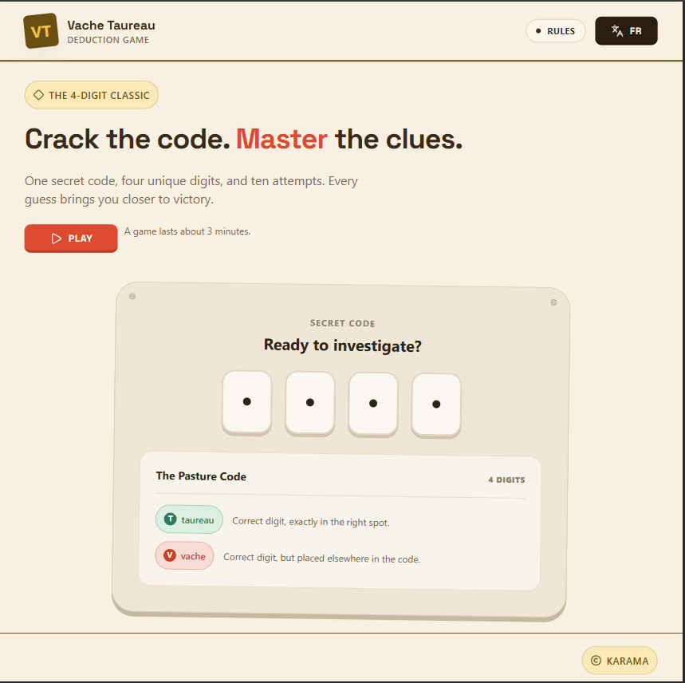

# Vache-Taureau 🐂🐄

A code-breaking game: guess the secret number in **10 tries**. After each guess you get feedback:

- **Taureau (bull):** right digit, right position
- **Vache (cow):** right digit, wrong position

👉 **Play it here:** [[Demo-Link](https://vt-game-gamma.vercel.app/)]


## Features

- Secret number of 4 digits, 10 attempts per game
- Win and fail screens with a celebratory animation
- English / French with a language switcher
- Light and dark theme (light by default)
- Game progress survives a page refresh
- Responsive layout, playable on mobile

## Tech stack

| Area | Tools |
|---|---|
| Framework | Next.js (App Router), React, TypeScript |
| Styling | Tailwind CSS |
| i18n | next-intl (routes under `app/[locale]`) |
| Theming | next-themes |
| Hosting | Vercel (+ Vercel Analytics) |

## Getting started

```bash
git clone https://github.com/Karama-karama/VT-game
cd vache-taureau
npm install
npm run dev
```

Open http://localhost:3000.

## How it works

- The game screen lives on a single `/game` route and renders either the playing, winner or failed view depending on game state.
- Game state (secret, attempts, status) is persisted in `localStorage`, so a refresh doesn't lose your progress.
- Translations live in `[messages/ path]`, and adding a language means adding one file there.

## Known limitations

- The secret is stored client-side in `localStorage`, so it's fine for a casual game but not tamper-proof. Moving game logic to the server is planned.

## Roadmap

- [ ] Passwordless authentication (email / social) with a guest mode kept
- [ ] Player profiles (name and avatar)
- [ ] Multiplayer rooms: shared secret code, first to crack it wins, live progress (x/10) of opponents

## Author

Built by [Karama Aissaoui](https://www.linkedin.com/in/karama-aissaoui-/) · [GitHub](https://github.com/Karama-karama)
